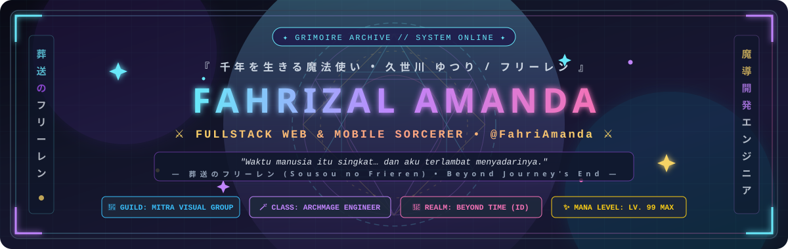
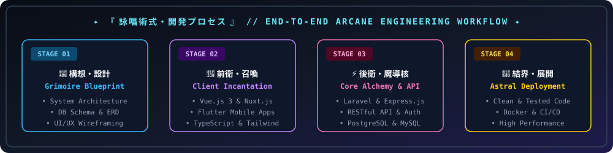

<div align="center">

<!-- ═══════════════════════════════════════════════════════════════════════════
     ✦ HERO BANNER // 葬送のフリーレン • ARCANE GRIMOIRE HEADER ✦
════════════════════════════════════════════════════════════════════════════ -->


<br/>

<!-- ✦ ANIMATED TYPING INCANTATION ✦ -->
<a href="https://github.com/FahriAmanda">
  
</a>

<br/>

<!-- ✦ GUILD STATUS & QUICK NAVIGATION BADGES ✦ -->
<p align="center">
  
  
  
  
</p>

<p align="center">
  <a href="mailto:fahrizalamanda03@gmail.com">
    
  </a>
  <a href="https://github.com/FahriAmanda">
    
  </a>
  
  
</p>

</div>


<!-- ═══════════════════════════════════════════════════════════════════════════
     ✦ 01 // 自己紹介 • ADVENTURER LORE & ABOUT ME ✦
════════════════════════════════════════════════════════════════════════════ -->
##  『 01 // 自己紹介 』 — Adventurer Dossier &amp; Lore

<table>
  <tr>
    <td width="68%" valign="top">
      <h3>🧙‍♀️ こんにちは！ I'm <b>Fahrizal Amanda</b> <i>(フリーレン / Frieren)</i></h3>
      <p>
        Seorang <b>Software Developer &amp; Fullstack Engineer</b> di <b>Mitra Visual Group (MVG)</b> yang berfokus merancang dan membangun aplikasi <b>Web &amp; Mobile</b> yang cepat, bersih, <i>scalable</i>, dan elegan. Layaknya perjalanan seribu tahun seorang penyihir elf yang mengumpulkan <i>grimoire</i> langka, saya terus mengeksplorasi teknologi modern untuk menciptakan solusi digital yang berdampak nyata.
      </p>
      <blockquote>
        <i>"人間の寿命は短いってわかっていたのに… なんで私はもっと知ろうとしなかったんだろう。"</i><br/>
        <b>"Waktu manusia itu singkat… dan aku terlambat menyadarinya."</b> — <i>Sousou no Frieren</i>
      </blockquote>
      <p>
        🎯 <b>Current Quest (任務):</b> Mengembangkan ekosistem aplikasi enterprise, CMS, &amp; platform modern di <b>Mitra Visual Group</b>.<br/>
        ⚔️ <b>Main Grimoire (得意魔法):</b> <code>Vue.js</code> • <code>Nuxt.js</code> • <code>Laravel</code> • <code>Express.js</code> • <code>Flutter</code> • <code>TypeScript</code> • <code>PostgreSQL</code><br/>
        🌸 <b>Engineering Philosophy (信念):</b> <i>"Code live bro — write clean architecture today so your future self won't cast a curse tomorrow."</i><br/>
        💬 <b>Pronouns (代名詞):</b> He / Him &nbsp;|&nbsp; 🌐 <b>Languages:</b> Bahasa Indonesia, English, 日本語 (Anime Enthusiast)
      </p>
    </td>
    <td width="32%" align="center" valign="middle">
      
      <br/><br/>
      
      <br/>
      <sub><i>✦ Zoltraak! Compiling clean code into production ✦</i></sub>
    </td>
  </tr>
</table>

<br/>

<!-- ✦ RPG STATUS CARD SVG ✦ -->
<div align="center">
  
</div>

<br/>

```yaml
# ─── ✦ 魔導書プロファイル // ARCHMAGE_GRIMOIRE.YML ✦ ───────────────────────────
adventurer:
  name: "Fahrizal Amanda"
  japanese_alias: "フリーレン (Frieren) / 久世川 ゆつり (Yutsuri Hisekawa)"
  username: "@FahriAmanda"
  class: "Fullstack Web & Mobile Engineer (二刀流の魔導エンジニア)"
  guild: "Mitra Visual Group (MVG)"
  location: "Somewhere beyond time • Indonesia 🇮🇩"

arcane_specializations:
  frontend_sorcery:   ["Vue.js 3", "Nuxt.js", "TypeScript", "JavaScript (ES6+)", "Tailwind CSS"]
  backend_alchemy:    ["PHP", "Laravel", "Node.js", "Express.js", "RESTful API", "Microservices"]
  mobile_summoning:   ["Flutter", "Dart", "Cross-Platform iOS & Android"]
  database_grimoire:  ["PostgreSQL", "MySQL", "Query Optimization", "Relational Schema Design"]

current_status:
  mana_source: "☕ Coffee, Late-Night Lo-Fi & Anime OSTs"
  active_quest: "Building high-performance web & mobile ecosystems from the ground up"
  motto: "A journey of a thousand miles begins with a single commit."
```


<!-- ═══════════════════════════════════════════════════════════════════════════
     ✦ 02 // 魔導書と武装 • ARCANE TECH STACK & ARSENAL ✦
════════════════════════════════════════════════════════════════════════════ -->
##  『 02 // 魔導書と武装 』 — Arcane Tech Stack &amp; Arsenal

<div align="center">
  <p><i>「 現代のシステムを構築するために選び抜かれた魔導具と詠唱言語 」</i></p>
  <a href="https://github.com/FahriAmanda">
    
  </a>
</div>

<br/>

<table width="100%">
  <thead>
    <tr>
      <th width="25%" align="center">🌸 前衛魔法<br/><sub>Frontend &amp; UI Sorcery</sub></th>
      <th width="25%" align="center">⚡ 後衛魔法<br/><sub>Backend &amp; API Alchemy</sub></th>
      <th width="25%" align="center">📱 召喚魔法<br/><sub>Mobile &amp; Cross-Platform</sub></th>
      <th width="25%" align="center">🗄️ 記憶魔導書 &amp; 魔導具<br/><sub>Database &amp; DevOps</sub></th>
    </tr>
  </thead>
  <tbody>
    <tr>
      <td align="center" valign="top">
        <br/>
        <br/><br/>
        <br/><br/>
        <br/><br/>
        <br/><br/>
        <br/><br/>
        <sub>Reactive SPA/SSR interfaces, state management, &amp; responsive pixel-perfect design systems.</sub>
      </td>
      <td align="center" valign="top">
        <br/>
        <br/><br/>
        <br/><br/>
        <br/><br/>
        <br/><br/>
        <br/><br/>
        <sub>Scalable backend architecture, secure authentication, CMS engines, &amp; high-throughput APIs.</sub>
      </td>
      <td align="center" valign="top">
        <br/>
        <br/><br/>
        <br/><br/>
        <br/><br/>
        <br/><br/>
        <br/><br/>
        <sub>Smooth 60fps cross-platform mobile apps for Android &amp; iOS with native-grade UX.</sub>
      </td>
      <td align="center" valign="top">
        <br/>
        <br/><br/>
        <br/><br/>
        <br/><br/>
        <br/><br/>
        <br/><br/>
        <sub>Relational data modeling, indexing, containerization, &amp; streamlined deployment workflows.</sub>
      </td>
    </tr>
  </tbody>
</table>


<!-- ═══════════════════════════════════════════════════════════════════════════
     ✦ 03 // 詠唱術式・実績 • ENGINEERING WORKFLOW & QUEST CHRONICLES ✦
════════════════════════════════════════════════════════════════════════════ -->
##  『 03 // 詠唱術式・実績 』 — Arcane Workflow &amp; Featured Quests

<div align="center">
  
</div>

<br/>

### ⚔️ Active &amp; Completed Guild Quests (`主要プロジェクト`)

<table width="100%">
  <tr>
    <td width="50%" valign="top">
      <h4>💎 <a href="https://github.com/FahriAmanda/mvg_pricelist">mvg_pricelist</a> — <i>Interactive Pricelist &amp; Catalog Platform</i></h4>
      <p>
        Aplikasi katalog dan manajemen daftar harga interaktif untuk <b>Mitra Visual Group (MVG)</b> yang dibangun dengan arsitektur frontend reaktif, pencarian instan, dan antarmuka modern yang responsif.
      </p>
      <p>
        
        
        
        
      </p>
    </td>
    <td width="50%" valign="top">
      <h4>🏰 <b>MVG Enterprise CMS &amp; Internal Ecosystem</b> — <i>Fullstack &amp; Mobile Suite</i></h4>
      <p>
        Sistem manajemen konten (CMS), layanan RESTful API terintegrasi, serta aplikasi mobile lintas platform untuk mendukung operasional bisnis dan visual secara <i>real-time</i>.
      </p>
      <p>
        
        
        
        
      </p>
    </td>
  </tr>
</table>

<details>
  <summary><b>📖 『 魔導書 第壱巻 』 // Grimoire Vol. I — Engineering Principles &amp; Clean Architecture (Click to Unseal)</b></summary>
  <br/>
  <ul>
    <li><b>🧩 Modular &amp; Maintainable Spellcraft:</b> Memisahkan <i>business logic</i>, <i>presentation layer</i>, dan <i>data access layer</i> agar kode mudah diuji dan dikembangkan jangka panjang.</li>
    <li><b>⚡ Performance-First Incantation:</b> Optimasi query database (PostgreSQL/MySQL), <i>lazy-loading</i> komponen di Vue/Nuxt, dan <i>state management</i> yang efisien di Flutter.</li>
    <li><b>🛡️ Defensive Barrier Magic:</b> Validasi ketat di sisi server (Laravel/Express), autentikasi berbasis token yang aman, serta penanganan error yang terstruktur.</li>
  </ul>
</details>

<details>
  <summary><b>📖 『 魔導書 第弐巻 』 // Grimoire Vol. II — Frieren's Wisdom &amp; Favorite Quotes (Click to Unseal)</b></summary>
  <br/>
  <blockquote>
    🌸 <i>"The greatest joy of magic lies in searching for it."</i> — <b>Frieren (葬送のフリーレン)</b><br/>
    🌸 <i>"Keindahan terbesar dari pemrograman terletak pada proses mempelajarinya dan memecahkan masalah yang sebelumnya tampak mustahil."</i><br/>
    🌸 <i>"A journey of a thousand miles begins with a single step — and a thousand-feature platform begins with a clean initial commit."</i>
  </blockquote>
</details>


<!-- ═══════════════════════════════════════════════════════════════════════════
     ✦ 04 // 冒険の記録 • GUILD CHRONICLES & GITHUB ANALYTICS ✦
════════════════════════════════════════════════════════════════════════════ -->
##  『 04 // 冒険の記録 』 — Guild Chronicles &amp; GitHub Analytics

<div align="center">

  <!-- Row 1: Profile Details Summary Card -->
  <a href="https://github.com/FahriAmanda">
    
  </a>

  <br/><br/>

  <!-- Row 2: Streak Stats + Stats + Top Languages -->
  <a href="https://github.com/FahriAmanda">
    
  </a>
  <a href="https://github.com/FahriAmanda">
    
  </a>
  <a href="https://github.com/FahriAmanda">
    
  </a>

</div>


<!-- ═══════════════════════════════════════════════════════════════════════════
     ✦ 05 // 通信魔法 • SUMMON & CONNECT (EPILOGUE) ✦
════════════════════════════════════════════════════════════════════════════ -->
##  『 05 // 通信魔法 』 — Send a Familiar &amp; Connect

<div align="center">

  

  <h3>✨ <i>"Mari berkolaborasi dan menciptakan sihir digital bersama!"</i> ✨</h3>
  <p>
    Tertarik berdiskusi soal proyek <b>Web App (Vue / Nuxt / Laravel / Express)</b>, <b>Mobile App (Flutter)</b>, atau sekadar ngobrol seputar teknologi &amp; anime?<br/>
    Jangan ragu untuk menghubungi saya melalui kanal komunikasi di bawah ini:
  </p>

  <p>
    <a href="mailto:fahrizalamanda03@gmail.com">
      
    </a>
    <a href="https://github.com/FahriAmanda">
      
    </a>
  </p>

  <br/>

  <p>
    <sub>
      <b>『 葬送のフリーレン • Beyond Journey's End 』</b><br/>
      <i>"A journey of a thousand miles begins with a single step."</i><br/>
      Crafted with 💜, Mana, &amp; Clean Code by <b>Fahrizal Amanda (@FahriAmanda)</b>
    </sub>
  </p>

  <!-- Animated Waving Footer -->
  

</div>
